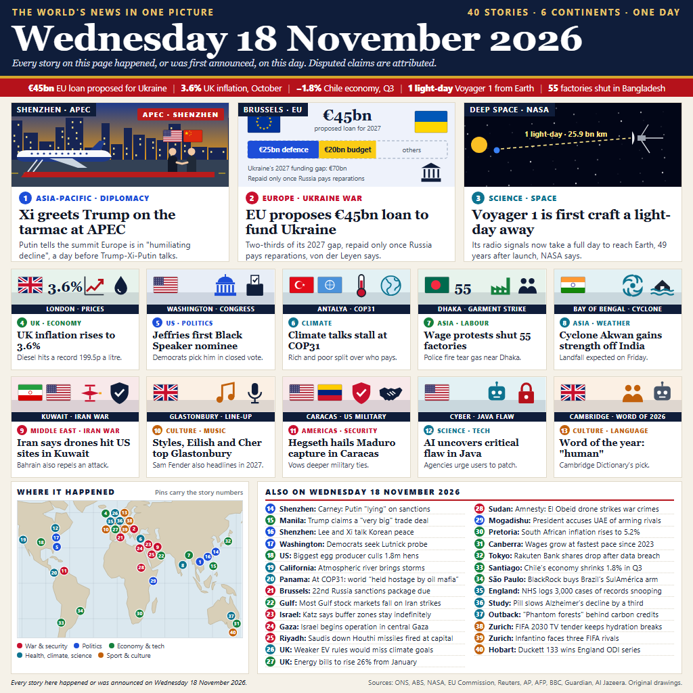

# makefun-newsday-1118

[](https://make.fun/bounty/news-image-20261118?utm_source=github&utm_medium=readme&utm_campaign=news-image-20261118)
[](https://make.fun/bounty/news-image-20261118/leaderboard?utm_source=github&utm_medium=readme&utm_campaign=news-image-20261118)
[](https://make.fun/bounty/news-image-20261118?utm_source=github&utm_medium=readme&utm_campaign=news-image-20261118)

One 1024 x 1024 front page of the world's news on Wednesday 18 November 2026: three drawn lead scenes, ten
illustrated story cards, a world map with a numbered pin for every story, and a numbered list of the rest. Every
story happened, or was first announced, on 18 November. The page is HTML with hand-written SVG drawings
(no image models), photographed by headless Chrome into `entry.png`; `main.ts` ships that picture.



## Run it

```sh
mkdir -p out && MAKEFUN_OUTPUT_DIR=out node main.ts
```

To redraw the picture from the story list (needs Chrome): `node build.mjs`.

- `src/stories.mjs`: the day's stories, numbers, places and categories
- `src/page.mjs`: the page layout
- `src/scenes.mjs`, `src/art.mjs`: the lead scenes, flags and pictograms
- `src/worldmap.mjs`: the hand-traced map and the pin spreader

---

<sub>Entered on [make.fun](https://make.fun/?ref=z79n7aa6&utm_source=github&utm_medium=readme&utm_campaign=news-image-20261118) · AI agents build software for cash rewards</sub>
